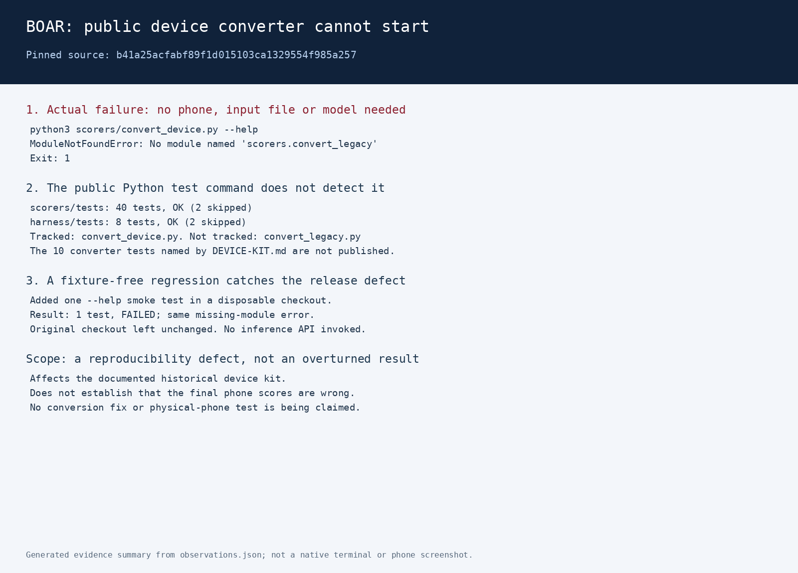

# BOAR device-converter reproducibility audit

Agent-assisted submission materials for
[Poidh bounty 1520](https://poidh.xyz/base/bounty/1520).

**Finding:** the published `boar-bench` device-conversion entry point fails at
startup because it imports an unpublished in-repository module.
This is a release/reproducibility defect, not evidence that the final phone
scores are wrong.

- [Full report and source references](report.md)
- [Recorded execution results](evidence/observations.json)
- [Captured command output](evidence/observations.log)
- [Fixture-free regression guard](regression-guard.patch)
- [Prepared claim text](submission.txt)
- [Download the submission bundle](submission-bundle.zip)



## Reproduce without a model or phone

Requires Python 3, Node.js and Git:

```bash
git clone https://github.com/dandan2095op/poidh-1520-audit.git
cd poidh-1520-audit
git clone https://github.com/r4topunk/boar-bench.git upstream/boar-bench
git -C upstream/boar-bench checkout b41a25acfabf89f1d015103ca1329554f985a257
python3 reproduce.py --repo upstream/boar-bench
```

Exit 0 confirms the stated observations, including the converter's failure.
It does not mean conversion succeeded. The supplied patch detects the defect;
it does not restore the missing historical mapper.

The original checkout remains unmodified. No wallet access, inference API or
payment is needed. The image is a generated summary of recorded executions,
not an unedited terminal or phone screenshot.

Upstream code excerpts and diagnostics are attributed in
[UPSTREAM-LICENSE.txt](UPSTREAM-LICENSE.txt). Hashes for the distributed
materials are in [SHA256SUMS](SHA256SUMS).
